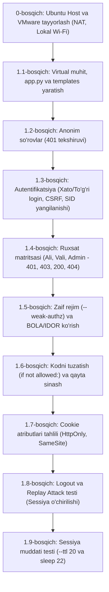

# Veb Dasturlar Xavfsizligi: A4 Amaliy Mashg‘ulot Qo‘llanmasi

**Mavzu:** A4. Server tomoni arxitekturasi, autentifikatsiya va avtorizatsiya  
**Variant:** 1-VARIANT — Talabalar hujjatlari portalida sessiya, rollar va obyektga kirish huquqlarini tekshirish  
**Operatsion tizim muhiti:** Host OS: **Ubuntu Linux** $\rightarrow$ Gipervizor: **VMware Workstation / Player for Linux** $\rightarrow$ Mehmon VM: **Ubuntu Server / Desktop 24.04 LTS**  
**Tarmoq muhiti:** **Shaxsiy / Uy lokal Wi-Fi tarmog‘i** (Universitet proksisisiz, to‘g‘ridan-to‘g‘ri internet ulanishi)  

---

## 1. MAVZUNING MAQSADI VA KUTILADIGAN NATIJALAR

### 1.1. Asosiy maqsad
Ushbu laboratoriya mashg‘ulotining asosiy maqsadi — talabalarda zamonaviy veb-ilovalarning server tomoni (Backend / Server-side) arxitekturasi, foydalanuvchi identifikatsiyasi (Autentifikatsiya) va ruxsatlarni boshqarish (Avtorizatsiya) mexanizmlari hamda ulardagi zaifliklarni aniqlash va bartaraf etish bo‘yicha amaliy ko‘nikmalarni shakllantirishdir:
1. **Autentifikatsiya va Avtorizatsiyani aniq ajratish:** Foydalanuvchining shaxsini tasdiqlash («Kim kiryapti?») bilan uning resurslar ustida amal bajarish huquqini tekshirish («Bu foydalanuvchiga ushbu amalni bajarishga ruxsat bormi?») o‘rtasidagi farqni tushunish.
2. **Parollarni xavfsiz saqlash va tekshirish:** Ochiq parollar emas, balki tuz (salt) qo‘shilgan zamonaviy kriptografik xeshlar (`scrypt` algoritmi orqali `generate_password_hash` va `check_password_hash`) ishlash mexanizmini hamda vaqt bo‘yicha hujumlar (Timing attacks) va foydalanuvchi mavjudligini oshkor qilish (Username Enumeration) xatarlarining oldini olish choralarini o‘rganish.
3. **Sessiyalarni boshqarish va Sessiya fiksatsiyasidan himoya:** Tasodifiy, kriptografik xavfsiz identifikatorlar (`secrets.token_urlsafe`) yaratish, kirish (login) muvaffaqiyatli bo‘lganda eski vaqtinchalik identifikatorni bekor qilib yangi sessiya identifikatori (`SID`) berish (Session Fixation profilaktikasi) jarayonini kuzatish.
4. **Rol (RBAC) va Obyekt (OBAC / ABAC) darajasidagi ruxsatlarni tekshirish:** Rol nazorati (talaba / admin) obyekt darajasidagi egalikni (talabaning shaxsiy hujjati) avtomatik ta’minlay olmasligini, interfeysdagi havolalarni yashirish yoki URL parametrlarini almashtirish (`?role=admin`) orqali xavfsizlikka erishib bo‘lmasligini isbotlash.
5. **BOLA / IDOR zaifligini amalda ko‘rish va tuzatish:** Obyekt darajasidagi ruxsat nazorati buzilishi (Broken Object Level Authorization / Insecure Direct Object References) oqibatida boshqa talabaning maxfiy hujjatini o‘qish holatini tahlil qilish va server kodida tekshiruv shartini qat’iylashtirish orqali zaiflikni tuzatish.
6. **Sessiyaning hayot sikli va Chiqish (Logout) xavfsizligi:** Chiqish amali faqat mijoz brauzeridagi cookie faylini o‘chirish bilan cheklanmasdan, server xotirasidagi sessiya yozuvini ham butunlay yo‘q qilishi (`SESSIONS.pop()`) shartligini Replay hujumi orqali isbotlash hamda sessiyaning mutlaq amal qilish muddati (TTL) tugashini tekshirish.

### 1.2. Kutiladigan natijalar
* Talaba HTTP `401 Unauthorized`, `403 Forbidden` va `404 Not Found` status kodlarini to‘g‘ri talqin qiladi va farqlaydi.
* Kriptografik xeshlash algoritmi nima sababdan bir tomonlama (one-way) ekanligini va nima uchun serverda ochiq parol saqlanmasligini asoslaydi.
* Tizimga kirishdan oldingi va keyingi cookie (`a4_sid`) identifikatorlarini solishtirib, sessiya yangilanganini ko‘rsatadi.
* Ruxsat matritsasini to‘liq amaliy sinovlar orqali to‘ldiradi.
* Zaif rejimda (`--weak-authz`) Alining akkaunti orqali Valining shaxsiy `102`-hujjatini olib, IDOR zaifligini isbotlaydi.
* Kodni to‘g‘rilab (`if not allowed:`), qayta sinovdan o‘tkazadi va hatto `--weak-authz` bayrog‘i ostida ham tizim mustahkam ishlashini dalillaydi.
* Chiqishdan so‘ng eski cookie nusxasi bilan tizimga kirish urinishi rad etilishini (Replay attack prevention) namoyish etadi.
* Sessiya muddati 20 soniya etib belgilanganda, vaqt tugashi bilan avtomatik sessiya yopilishini ko‘rsatadi.

### 1.3. Mashg‘ulot parametrlari va Maxsus Muhit Izohi
* **Tavsiya etilgan vaqt:** 80 daqiqa (asosiy laboratoriya ishi).
* **Asosiy tizim (Host OS):** **Ubuntu Linux** (Windows emas!). Barcha fayllarni boshqarish, VMware ni ishga tushirish va arxivlarni ochish Ubuntu terminali orqali bajariladi.
* **Virtualizatsiya:** **VMware Workstation Pro / Player for Linux**.
* **Virtual Mashina (Guest OS):** Ubuntu Desktop 24.04 LTS yoki Ubuntu Server 24.04 (4 vCPU, 8 GB RAM yoki 4 GB RAM, xotira hajmi yetarli bo‘lsa).
* **Tarmoq muhiti (Lokal Wi-Fi):** Talaba **shaxsiy/uy Wi-Fi tarmog‘ida** ishlaydi. 
  > [!IMPORTANT]
  > Universitet hujjatida keltirilgan `172.18.1.1:2500` proksi manzili, `/etc/apt/apt.conf.d/99proxy` fayli va `\\172.18.233.234\files` SMB serveri faqat universitet ichki tarmog‘iga tegishli! Shaxsiy Wi-Fi tarmog‘ida ushbu proksilar **sozlanmaydi** (aks holda `apt` va internet butunlay bloklanib qoladi). Virtual mashinaning tarmoq kartasi oddiy **NAT** rejimiga o‘rnatiladi, bu esa host tizimdagi Wi-Fi internetini to‘g‘ridan-to‘g‘ri VM ichiga uzatadi.
* **Laboratoriya manzili:** `http://127.0.0.1:8004/` (Lokal loopback manzili, xizmat va sinov vositalari bitta muhit ichida ishlaydi).
* **Baholash:** Jami 10 ball (D1, D2, D3, D4, D5 dalillari va hisobot asosida).

### 1.4. O‘quv Akkauntlari va Hujjatlar Tuzilmasi

| Foydalanuvchi nomi | Laboratoriya Paroli | Tizimdagi Roli | ID raqami | Huquq doirasi va Hujjatlar |
| :--- | :--- | :--- | :--- | :--- |
| `ali` | `Ali-A4-Only!` | `student` | `1` | Faqat o‘zining `101`-raqamli o‘quv hujjati |
| `vali` | `Vali-A4-Only!` | `student` | `2` | Faqat o‘zining `102`-raqamli o‘quv hujjati |
| `admin` | `Admin-A4-Only!` | `admin` | `3` | Barcha hujjatlar (`101`, `102`) va `/api/admin` hisoboti |

---

## 2. FAYLDA KELTIRILGAN BARCHA MAVZULAR BO‘YICHA TO‘LIQ QO‘LLANMA

### 2.1. Server Tomoni Arxitekturasi va Ishonch Chegarasi (Trust Boundary)
* **Qayerda qo‘llaniladi?** Veb-ilovaning backend tizimini loyihalashda.
* **Mohiyati:**
  * Veb-arxitekturada eng muhim qoida: **Mijoz tomoniga (Frontend, Brauzer) hech qachon ishonib bo‘lmaydi**.
  * Brauzerdan kelayotgan har qanday so‘rov (URL parametrlari, HTTP sarlavhalar, Cookie, Forma kiritmalari, JSON tana qismi) buzg‘unchi tomonidan o‘zgartirilishi mumkin.
  * Masalan, foydalanuvchi URL manziliga `?role=admin` deb yozsa yoki brauzerda HTML elementini `Inspect Element` orqali ko‘rinadigan qilib qo‘ysa, server bu ma’lumotga qarab qaror qabul qilmasligi shart.
  * Serverda ma’lumotlar oqimi quyidagi qatlamlar orqali boshqariladi:
    1. **Model qatlami (`USERS`, `DOCS`, `SESSIONS`):** Foydalanuvchilar ma’lumotlari, ularning haqiqiy rollari va hujjat egaligi saqlanadigan ishonchli ombor.
    2. **Controller mantiqi (`login`, `me`, `admin`, `document`, `logout`):** Kelayotgan HTTP so‘rovini qabul qiladi, autentifikatsiyani tekshiradi, ruxsat berish yoki rad etish haqida qaror chiqaradi.
    3. **View qatlami (`templates/index.html`):** Foydalanuvchiga faqat natijani ko‘rsatadi. U hech qanday xavfsizlik mantig‘iga ega emas.

---

### 2.2. Autentifikatsiya (Authentication) va Parollarni Xeshlash
* **Qayerda qo‘llaniladi?** Foydalanuvchi shaxsini aniqlash va tekshirishda (`/login`).
* **Autentifikatsiya nima?**  
  Foydalanuvchi o‘zining kimligini da’vo qilganda (login kiritganda), uning haqiqatan ham shu shaxs ekanligini isbotlash jarayoni (odatda parol orqali).
* **Parollarni saqlash xavfsizligi:**
  * **Ochiq matn (Plaintext) xavfi:** Parollar ma’lumotlar bazasida hech qachon ochiq saqlanmaydi. Agar baza sizib chiqsa, barcha parollar oshkor bo‘ladi.
  * **Kriptografik xesh:** Xesh funksiyasi — bu bir tomonlama (one-way) matematik funksiya bo‘lib, undan parolni qayta tiklab bo‘lmaydi.
  * **Tuz (Salt):** Har bir parol uchun tasodifiy tuz qo‘shiladi. Bu bir xil parol kiritgan ikki foydalanuvchining xeshlari butunlay boshqacha bo‘lishini ta’minlaydi va kamalak jadvallari (Rainbow Tables) orqali parollarni topish hujumlarini bartaraf qiladi.
  * **`scrypt` algoritmi:** Werkzeug kutubxonasi xotiraga yuklama beruvchi zamonaviy `scrypt` algoritmidan foydalanadi (`generate_password_hash`).
* **Vaqt bo‘yicha hujumlar (Timing Attacks) va `DUMMY_HASH`:**
  * Agar foydalanuvchi bazada mavjud bo‘lmasa va server darhol «Login topilmadi» deb tez javob qaytarsa, tajovuzkor so‘rov vaqtini (millisoniyalarni) o‘lchab, qaysi loginlar mavjud ekanligini bilib olishi mumkin (Username Enumeration).
  * Shuning uchun kodda `DUMMY_HASH` yaratilgan. Foydalanuvchi bazada bo‘lmasa ham, server baribir soxta xesh bilan parolni tekshirishga vaqt sarflaydi (`check_password_hash(DUMMY_HASH, password)`), natijada mavjud va mavjud bo‘lmagan loginlar uchun server javob vaqti deyarli tenglashadi.
  * Shuningdek, xato xabari login va parol uchun umumiy qilib chiqariladi: «Login yoki parol xato».

---

### 2.3. Avtorizatsiya (Authorization): RBAC va OBAC Farqi
* **Qayerda qo‘llaniladi?** Resurslarga kirish huquqini belgilashda (`/api/admin`, `/api/docs/<id>`).
* **Avtorizatsiya nima?**  
  Autentifikatsiyadan o‘tgan foydalanuvchiga muayyan resursni ko‘rish, o‘zgartirish yoki o‘chirish vakolatini tekshirish jarayoni.
* **HTTP Javob Status Kodlari:**
  * **`401 Unauthorized`:** Foydalanuvchi umuman autentifikatsiyadan o‘tmagan (anonim mehmon, cookie yo‘q yoki muddati o‘tgan). «Avval shaxsingni tasdiqla!».
  * **`403 Forbidden`:** Foydalanuvchi kimligi aniq (login qilgan), ammo uning ushbu resursga kirish huquqi yo‘q. «Shaxsing ma’lum, lekin bu yerga kirishga haqqing yo‘q!».
  * **`404 Not Found`:** Resurs bazada mavjud emas. (Ba’zi xavfsiz tizimlarda begonaning hujjati mavjudligini ham oshkor qilmaslik uchun 403 o‘rniga ataylab 404 qaytariladi).
* **RBAC va OBAC taqqoslash:**
  * **RBAC (Role-Based Access Control):** Huquqlar foydalanuvchi roliga (masalan, `student`, `teacher`, `admin`) qarab belgilanadi. Masalan, `/api/admin` sahifasiga faqat `role == 'admin'` foydalanuvchilar kira oladi.
  * **OBAC / ABAC (Object/Attribute-Based Access Control):** Resursga kirish nafaqat rolga, balki **obyektning xususiyatlariga (egalik huquqiga)** ham bog‘liq bo‘ladi.
  * **Xatolik manbai:** «U talaba rolida, demak u talabalar hujjatini o‘qiy oladi» deyish xatodir! Chunki talaba A o‘zining `101`-hujjatini o‘qishi kerak, ammo talaba B ning `102`-hujjatini o‘qiy olmasligi shart.

---

### 2.4. Broken Object Level Authorization (BOLA / IDOR) Zaifligi
* **Qayerda qo‘llaniladi va mohiyati nima?**
  * OWASP API Security Top 10 ro‘yxatida 1-o‘rinda turuvchi eng xavfli zaifliklardan biri.
  * **IDOR (Insecure Direct Object References):** Dastur foydalanuvchi so‘ragan obyekt identifikatorini (masalan, `/api/docs/102`) to‘g‘ridan-to‘g‘ri qabul qiladi, lekin joriy kirgan foydalanuvchi shu obyektning haqiqiy egasi ekanligini server tomonida tekshirmaydi.
* **Laboratoriyadagi zaiflik mexanizmi:**
  * Laboratoriya dasturida quyidagi tekshiruv mavjud:
    ```python
    allowed = user['role'] == 'admin' or doc['owner'] == user['id']
    if not app.config['WEAK_AUTHZ'] and not allowed:
        return fail(403, 'Bu hujjatga ruxsat yoq.')
    ```
  * Agar server `--weak-authz` bilan ishga tushirilsa, `app.config['WEAK_AUTHZ']` qiymati `True` bo‘ladi, natijada `not app.config['WEAK_AUTHZ']` ifodasi `False` ga aylanadi va tekshiruv sharti butunlay tashlab ketiladi!
  * Natijada Ali (ID: 1) o‘z brauzeri orqali `/api/docs/102` manziliga murojaat qilib, Valining shaxsiy ma’lumotlarini ko‘ra oladi.
* **To‘g‘ri yechim:**
  * Rejim bayroqlaridan qat’i nazar, server har doim va so‘zsiz obyekt egasini tekshirishi shart:
    ```python
    if not allowed:
        return fail(403, 'Bu hujjatga ruxsat yoq.')
    ```

---

### 2.5. Sessiyalarni Boshqarish va Session Fixation Himoyasi
* **Qayerda qo‘llaniladi?** Foydalanuvchining tizimga kirganlik holatini saqlashda.
* **Sessiya qanday ishlaydi?**
  * HTTP protokoli holatsiz (stateless) protokoldir — har bir so‘rov avvalgisidan mustaqil.
  * Shuning uchun server foydalanuvchi tizimga kirgach, unga noyob sessiya identifikatori (`SID`) beradi va uni `Set-Cookie` orqali brauzerga yuboradi. Brauzer har keyingi so‘rovda shu cookieni serverga qaytaradi.
* **In-Memory Sessiya:**
  * Ushbu laboratoriyada sessiyalar serverning operativ xotirasidagi `SESSIONS = {}` lug‘atida saqlanadi. Server qayta yuklansa, barcha sessiyalar o‘chib ketadi.
* **Session Fixation (Sessiyani mustahkamlash) hujumi:**
  * Agar anonim foydalanuvchi saytga kirganda berilgan SID foydalanuvchi login qilgandan keyin ham o‘zgarmasdan qolsa, tajovuzkor jabrlanuvchiga oldindan ma’lum bo‘lgan SIDni o‘rnatib qo‘yishi va u login qilgach uning hisobiga kirib olishi mumkin.
* **Laboratoriyadagi himoya mexanizmi:**
  * Kodda login muvaffaqiyatli bo‘lishi bilanoq:
    ```python
    SESSIONS.pop(sid, None)       # Eski vaqtinchalik anonim SID o'chiriladi
    new_sid, _ = issue_session(name) # Yangi autentifikatsiyalangan SID yaratiladi
    ```
  * Bu jarayon sessiyani yangilash (Session Regeneration) deb ataladi va Session Fixation hujumini to‘liq bartaraf etadi.

---

### 2.6. Cookie Xavfsizlik Atributlari
* **Qayerda qo‘llaniladi?** `attach_cookie()` funksiyasida `Set-Cookie` sarlavhasini shakllantirishda.
* **Atributlar va ularning vazifalari:**

| Atribut | Laboratoriyadagi Qiymat | Xavfsizlik Vazifasi |
| :--- | :--- | :--- |
| `HttpOnly` | `True` | JavaScript kodiga (`document.cookie`) ushbu cookieni o‘qishni taqiqlaydi. Bu orqali XSS (Cross-Site Scripting) hujumi sodir bo‘lganda ham buzg‘unchi foydalanuvchi sessiya tokenini o‘g‘irlay olmaydi. |
| `SameSite` | `Lax` | Boshqa tashqi saytlardan amalga oshiriladigan so‘rovlarda cookielar avtomatik qo‘shilib ketishini cheklaydi (CSRF hujumlariga qarshi asosiy to‘siq). |
| `Path` | `/` | Cookie butun domen bo‘ylab amal qilishini ta’minlaydi. |
| `Secure` | `False` *(Laboratoriyada)* | Faqat shifrlangan HTTPS ulanishlar orqali uzatilishini talab qiladi. Ushbu laboratoriyada lokal `http://127.0.0.1` ishlatilgani sababli `False` qilingan; haqiqiy ishlab chiqarishda (production) **`Secure=True` bo‘lishi majburiy**. |

---

### 2.7. CSRF (Cross-Site Request Forgery) Himoyasi
* **Qayerda qo‘llaniladi?** `/login` va `/api/logout` kabi holatni o‘zgartiruvchi POST so‘rovlarida.
* **CSRF nima?**  
  Buzg‘unchining sayti jabrlanuvchi nomidan uning ruxsatisiz serverga qonuniy so‘rov (masalan, pul o‘tkazish yoki tizimdan chiqarib yuborish) yuborishi.
* **Synchronizer Token Pattern:**
  * Server har bir sessiya uchun sirli, taxmin qilib bo‘lmaydigan `csrf` tokenini yaratadi (`secrets.token_urlsafe(32)`).
  * Ushbu token HTML formaga yashirin maydon (`<input type="hidden" name="csrf">`) yoki maxsus sarlavha (`X-CSRF-Token`) sifatida qo‘shiladi.
  * Serverga so‘rov kelganda, server cookiedagi sessiyaga tegishli CSRF token bilan so‘rovdagi tokenni solishtiradi (`secrets.compare_digest`). Agar mos kelmasa, `403 Forbidden` qaytaradi.
* **Nima uchun Logoutda ham CSRF kerak?**  
  Agar logout CSRF bilan himoyalanmasa, tajovuzkor foydalanuvchini bilvosita tizimdan chiqarib yuborishi (Denial of Service) yoki uning sessiyasini buzishi mumkin.

---

### 2.8. Sessiyaning Hayot Sikli: Chiqish (Logout) va TTL (Time-To-Live)
* **Qayerda qo‘llaniladi?** Foydalanuvchi tizimdan chiqqanda yoki ma’lum vaqt faoliyatsiz turganda.
* **Faqat mijoz cookie-sini o‘chirish yetarlimi?**
  * **YO‘Q!** Agar foydalanuvchi brauzeridagi cookieni o‘chirsa-yu, server o‘z xotirasidagi yozuvni saqlab qolsa, buzg‘unchi o‘sha cookiening nusxasini saqlab olgan bo‘lsa (Replay Attack), tizimga qayta kirishi mumkin.
  * Shu sababli `/api/logout` chaqirilganda server xotirasidan `SESSIONS.pop(sid, None)` buyrug‘i bilan yozuv butunlay o‘chiriladi.
* **Sessiyaning amal qilish muddati (TTL - Time-To-Live):**
  * Sessiya abadiy yashamasligi kerak.
  * Oddiy rejimda: 1200 soniya (20 daqiqa).
  * Vaqt hisobi: `time.monotonic()` orqali yuritiladi (bu server soati o‘zgarishlaridan qat’i nazar oraliq vaqtni xatosiz o‘lchaydi).
  * Vaqt tugagach, so‘rov kelishi bilanoq sessiya yaroqsiz deb topiladi va xotiradan tozalanadi.

---

## 3. MASHQNI BAJARISH KETMA-KETLIGI VA CLI BUYRUQLAR QO‘LLANMASI

Ushbu bo‘limda barcha mashqlar **Ubuntu Host** tizimida **VMware Workstation** va **shaxsiy Wi-Fi** orqali ishlash sharoitiga moslashtirilgan. Har bir bajariladigan CLI komandaning nima ish qilishi va parametrlari to‘liq tushuntirib berilgan.



---

### 0-BOSQICH: TIZIMNI TAYYORLASH (UBUNTU HOST VA VMWARE SOZLAMALARI)

Sizning asosiy kompyuteringiz — **Ubuntu Linux**, internetingiz esa **shaxsiy lokal Wi-Fi**.

#### 0.1. Arxivni ochish va VMware orqali ishga tushirish (Ubuntu Hostda)
Agar sizda tayyor `Ubuntu_24.04_VM.7z` yoki ISO fayli bo‘lsa, uni Ubuntu terminalida oching:

```bash
sudo apt update && sudo apt install -y p7zip-full
mkdir -p ~/vmware/Veb-A4-LAB
7z x Ubuntu_24.04_VM.7z -o~/vmware/Veb-A4-LAB/
```

**CLI komandalar tushuntirishi:**
* `sudo apt update`: Ubuntu paketlar ro‘yxatini serverlar bilan sinxronlashtiradi.
* `sudo apt install -y p7zip-full`: `.7z` arxivlarini ochish uchun maxsus utilitani o‘rnatadi (`-y` barcha tasdiqlashlarga ha deb javob beradi).
* `mkdir -p ~/vmware/Veb-A4-LAB`: VM fayllari joylashadigan yangi papka yaratadi (`-p` agar ota papkalar bo‘lmasa ularni ham yaratadi).
* `7z x ... -o...`: Arxiv ichidagi `.vmx` va `.vmdk` fayllarini ko‘rsatilgan manzilga chiqaradi (`x` to‘liq strukturani saqlab ochadi).

Endi VMware Workstation dasturini ishga tushiring:
```bash
vmware &
```
* `File` $\rightarrow$ `Open` menyusi orqali `~/vmware/Veb-A4-LAB/` ichidagi `.vmx` faylini oching.
* VM ishga tushganda so‘rasa, **«I copied it»** tugmasini bosing (bu yangi individual MAC-manzil generatsiya qiladi).

#### 0.2. VM Tarmoq sozlamasi (Shaxsiy lokal Wi-Fi)
* VMware sozlamalarida (`VM -> Settings -> Network Adapter`):
  * **NAT (Network Address Translation)** rejimini tanlang.
  * **Connect at power on** belgisini yoqing.
  * **HECH QANDAY PROKSI KERAK EMAS!** Agar VM ichida avval universitet proksisi yozilgan bo‘lsa, uni tozalang:
    ```bash
    sudo rm -f /etc/apt/apt.conf.d/99proxy
    unset http_proxy https_proxy HTTP_PROXY HTTPS_PROXY
    ```
  * Bu buyruqlar VM to‘g‘ridan-to‘g‘ri sizning Wi-Fi internetingizdan foydalanishini ta’minlaydi.

#### 0.3. Virtual Mashina ichida xost nomini sozlash (Ubuntu VM konsolida)
Ubuntu VM ichida terminalni oching (`Ctrl+Alt+T`) va bajaring:

```bash
sudo hostnamectl set-hostname veb-a4-lab
whoami
id
sudo -v
date -Is
```

**CLI komandalar tushuntirishi:**
* `sudo hostnamectl set-hostname veb-a4-lab`: Virtual mashina nomini `veb-a4-lab` deb o‘rnatadi. Bu hisobotda boshqa mashinalardan ajralib turishi uchun kerak.
* `whoami`: Hozirgi foydalanuvchi nomini chiqaradi.
* `id`: Foydalanuvchining UID va GID raqamlarini hamda tegishli guruhlarini ko‘rsatadi.
* `sudo -v`: Sudo parolini tekshirib, sessiyani vaqtincha yangilaydi (keyingi buyruqlarda parol so‘ramasligi uchun).
* `date -Is`: Hozirgi vaqt va sanani xalqaro ISO-8601 formatida ko‘rsatadi (dalil sifatida hisobotga qo‘yiladi).

---

### 1.1-BOSQICH: ISHCHI MUHITNI TAYYORLASH VA ILOVANI YARATISH

#### Papkalarni yaratish va Python muhitini o‘rnatish:
```bash
sudo apt update
sudo apt install -y python3 python3-venv python3-pip curl nano
mkdir -p ~/websec/A4/templates
cd ~/websec/A4
python3 -m venv .venv
source .venv/bin/activate
python -m pip install Flask==3.1.3
python -m pip freeze > requirements-lock.txt
python -m pip show Flask Werkzeug
```

**CLI komandalar tushuntirishi:**
* `sudo apt install -y python3 python3-venv python3-pip curl nano`: Ish uchun zarur bo‘lgan Python 3, virtual muhit moduli (`python3-venv`), paket menejeri (`pip`), HTTP so‘rovlar vositasi (`curl`) va matn muharririni (`nano`) o‘rnatadi.
* `mkdir -p ~/websec/A4/templates`: A4 loyihasi uchun asosiy katalog va uning ichida HTML shablonlari uchun `templates` papkasini yaratadi.
* `cd ~/websec/A4`: Yangi yaratilgan loyiha papkasiga o‘tadi.
* `python3 -m venv .venv`: Loyiha uchun `.venv` nomli xavfsiz, izolyatsiyalangan Python virtual muhitini hosil qiladi. Tizim paketlari bilan konflikt bo‘lmaydi.
* `source .venv/bin/activate`: Virtual muhitni faollashtiradi (terminal qatorida `(.venv)` paydo bo‘ladi).
* `python -m pip install Flask==3.1.3`: Loyihaga aniq `3.1.3` versiyadagi Flask veb-freymvorkini o‘rnatadi (u avtomatik ravishda xavfsizlik funksiyalari uchun `Werkzeug` kutubxonasini ham o‘rnatadi).
* `python -m pip freeze > requirements-lock.txt`: O‘rnatilgan barcha kutubxonalar va ularning aniq versiyalarini faylga saqlab qo‘yadi (qayta tiklash va hisobot uchun).
* `python -m pip show Flask Werkzeug`: O‘rnatilgan Flask va Werkzeug paketlarining versiyasi, litsenziyasi va joylashuvini ekranga chiqaradi.

---

#### `app.py` Faylini Yaratish:
`~/websec/A4/app.py` faylini yarating (`nano app.py`) va unga quyidagi to‘liq kodni joylashtiring:

```python
import argparse
import secrets
import time
from flask import Flask, request, jsonify, make_response, render_template
from werkzeug.exceptions import HTTPException
from werkzeug.security import generate_password_hash, check_password_hash

app = Flask(__name__)
app.config.update(MAX_CONTENT_LENGTH=4096, TTL=1200, WEAK_AUTHZ=False)
COOKIE = 'a4_sid'
SESSIONS = {}
USERS = {
    'ali': {'id': 1, 'role': 'student',
            'hash': generate_password_hash('Ali-A4-Only!')},
    'vali': {'id': 2, 'role': 'student',
             'hash': generate_password_hash('Vali-A4-Only!')},
    'admin': {'id': 3, 'role': 'admin',
              'hash': generate_password_hash('Admin-A4-Only!')}
}
DUMMY_HASH = generate_password_hash('Unused-A4-Value!')
DOCS = {101: {'owner': 1, 'text': 'Alining oquv hujjati'},
        102: {'owner': 2, 'text': 'Valining oquv hujjati'}}

def get_session():
    sid = request.cookies.get(COOKIE, '')
    record = SESSIONS.get(sid)
    if record and time.monotonic() >= record['expires']:
        SESSIONS.pop(sid, None)
        record = None
    return sid, record

def issue_session(username=None):
    now = time.monotonic()
    for key in list(SESSIONS):
        if SESSIONS[key]['expires'] <= now:
            SESSIONS.pop(key, None)
    sid = secrets.token_urlsafe(32)
    record = dict(username=username, csrf=secrets.token_urlsafe(32),
                  expires=now + app.config['TTL'])
    SESSIONS[sid] = record
    return sid, record

def attach_cookie(response, sid):
    response.set_cookie(COOKIE, sid, httponly=True, samesite='Lax',
                        secure=False, path='/')  # Local HTTP only.
    return response

def fail(status, message):
    return jsonify(error=message), status

def valid_csrf(record):
    token = request.headers.get('X-CSRF-Token') or request.form.get('csrf', '')
    return bool(record and token and
                secrets.compare_digest(record['csrf'].encode(), token.encode()))

def current_user():
    _, record = get_session()
    return USERS.get(record['username']) if record else None

@app.after_request
def headers(response):
    response.headers['Cache-Control'] = 'no-store'
    response.headers['X-Content-Type-Options'] = 'nosniff'
    return response

@app.get('/')
@app.get('/api/csrf')
def entry():
    sid, record = get_session()
    if not record:
        sid, record = issue_session()
    if request.path == '/api/csrf':
        response = jsonify(csrf=record['csrf'])
    else:
        response = make_response(render_template('index.html',
            csrf=record['csrf'], username=record['username']))
    return attach_cookie(response, sid)

@app.post('/login')
def login():
    sid, record = get_session()
    if not valid_csrf(record):
        return fail(403, 'CSRF tekshiruvi bajarilmadi.')
    name = request.form.get('username', '')
    password = request.form.get('password', '')
    user = USERS.get(name)
    stored_hash = user['hash'] if user else DUMMY_HASH
    password_ok = check_password_hash(stored_hash, password)
    if not user or not password_ok:
        return fail(401, 'Login yoki parol xato.')
    SESSIONS.pop(sid, None)
    new_sid, _ = issue_session(name)
    response = jsonify(message='Kirish bajarildi.', role=user['role'])
    return attach_cookie(response, new_sid)

@app.get('/api/me')
def me():
    user = current_user()
    if not user:
        return fail(401, 'Avval tizimga kiring.')
    return jsonify(id=user['id'], role=user['role'])

@app.get('/api/admin')
def admin():
    user = current_user()
    if not user:
        return fail(401, 'Avval tizimga kiring.')
    if user['role'] != 'admin':
        return fail(403, 'Administrator huquqi kerak.')
    return jsonify(message='Administrator hisoboti', users=len(USERS))

@app.get('/api/docs/<int:doc_id>')
def document(doc_id):
    user = current_user()
    if not user:
        return fail(401, 'Avval tizimga kiring.')
    doc = DOCS.get(doc_id)
    if not doc:
        return fail(404, 'Hujjat topilmadi.')
    allowed = user['role'] == 'admin' or doc['owner'] == user['id']
    if not app.config['WEAK_AUTHZ'] and not allowed:
        return fail(403, 'Bu hujjatga ruxsat yoq.')
    return jsonify(id=doc_id, **doc)

@app.post('/api/logout')
def logout():
    sid, record = get_session()
    if not record or not record['username']:
        return fail(401, 'Faol sessiya yoq.')
    if not valid_csrf(record):
        return fail(403, 'CSRF tekshiruvi bajarilmadi.')
    SESSIONS.pop(sid, None)
    response = jsonify(message='Sessiya bekor qilindi.')
    response.delete_cookie(COOKIE, path='/')
    return response

@app.errorhandler(HTTPException)
def http_error(error):
    return fail(error.code or 500, 'Sorov bajarilmadi.')

if __name__ == '__main__':
    parser = argparse.ArgumentParser()
    parser.add_argument('--weak-authz', action='store_true')
    parser.add_argument('--ttl', type=int, default=1200)
    args = parser.parse_args()
    if args.ttl < 1:
        parser.error('--ttl musbat son bolishi kerak')
    app.config.update(WEAK_AUTHZ=args.weak_authz, TTL=args.ttl)
    app.run(host='127.0.0.1', port=8004, debug=False,
            use_reloader=False, threaded=False)
```

---

#### `templates/index.html` Faylini Yaratish:
`~/websec/A4/templates/index.html` faylini yarating (`nano templates/index.html`):

```html
<!doctype html>
<html lang="uz">
<meta charset="utf-8">
<title>A4: talabalar hujjatlari portali</title>
<style>
body {font: 18px sans-serif; max-width: 800px; margin: 30px auto;}
label {display: block; margin: 10px 0;}
button, input {padding: 8px;}
</style>
<h1>A4: talabalar hujjatlari portali</h1>
<p>Joriy foydalanuvchi: {{ username or 'mehmon' }}</p>
<form method="post" action="/login">
<input type="hidden" name="csrf" value="{{ csrf }}">
<label>Login <input name="username" required autocomplete="username"></label>
<label>Parol <input name="password" type="password" required
 autocomplete="current-password"></label>
<button>Kirish</button>
</form>
<p><a href="/api/me">Mening rolim</a> |
<a href="/api/docs/101">101-hujjat</a> |
<a href="/api/docs/102">102-hujjat</a> |
<a href="/api/admin">Administrator hisoboti</a></p>
<form method="post" action="/api/logout">
<input type="hidden" name="csrf" value="{{ csrf }}">
<button>Chiqish</button>
</form>
<p>JSON javobidan keyin shu bosh sahifani manzil orqali qayta oching.</p>
<p>Faqat o'quv akkauntlari. Brauzerga parolni saqlatmang.</p>
</html>
```

#### Kodni kompilyatsiya qilish va serverni ishga tushirish:
```bash
python -m py_compile app.py
python app.py
```

**CLI komandalar tushuntirishi:**
* `python -m py_compile app.py`: Python faylida sintaksis xatolar yoki chekinish (indentation) buzilishlari bor-yo‘qligini tekshiradi. Xato bo‘lmasa, hech narsa chiqarmaydi.
* `python app.py`: Flask veb-serverini `127.0.0.1:8004` manzilida ishga tushiradi. Ushbu terminal oyna ochiq qolishi kerak (server loglari ko‘rinib turadi).

---

### 1.2-BOSQICH: DASTLABKI HTTP TEKSHIRUVI (ANONIM SO‘ROVLAR)

Yangi ikkinchi terminal oynasini oching (`Ctrl+Alt+T`) va quyidagi buyruqlarni bajaring:

```bash
cd ~/websec/A4
A4_BASE=http://127.0.0.1:8004
curl --noproxy "*" -i "$A4_BASE/api/me"
curl --noproxy "*" -i "$A4_BASE/api/admin"
```

**CLI komandalar va kalitlar tushuntirishi:**
* `cd ~/websec/A4`: Ishchi katalogga o‘tadi.
* `A4_BASE=http://127.0.0.1:8004`: Server bazaviy manzilini qisqartma o‘zgaruvchiga oladi.
* `curl`: Tarmoq so‘rovlarini yuboruvchi dastur.
* `--noproxy "*"`: Hech qanday tashqi proksiga murojaat qilmasdan, to‘g‘ridan-to‘g‘ri lokal serverga ulanishni ta’minlaydi.
* `-i`: Server qaytargan HTTP status kod va sarlavhalarni (headers) ham terminalda ko‘rsatadi.
* `"$A4_BASE/api/me"`: So‘rov yuborilayotgan manzil.

**Kutiladigan natija:**
* Ikkala so‘rovga ham serverdan `HTTP/1.1 401 UNAUTHORIZED` qaytadi. Chunki so‘rovda cookie identifikatori mavjud emas.

---

### 1.3-BOSQICH: AUTENTIFIKATSIYA TAJRIBASI (XATO VA TO‘G‘RI LOGIN, CSRF VA SID)

#### 1. Xato parol va mavjud bo‘lmagan login tekshiruvi:
Firefox brauzerini oching (`http://127.0.0.1:8004/`) va `F12` tugmasi bilan Developer Tools $\rightarrow$ **Network** bo‘limini oching.
* `ali` va noto‘g‘ri parol kiriting $\rightarrow$ Javob: `401 Unauthorized`, xabar: `{"error": "Login yoki parol xato."}`.
* Bosh sahifani qayta oching va mavjud bo‘lmagan `hacker` loginini kiriting $\rightarrow$ Javob: yana aynan o‘sha `401 Unauthorized` va `{"error": "Login yoki parol xato."}`.
* **Xavfsizlik xulosasi:** Tizim mavjud va mavjud bo‘lmagan hisoblar uchun bir xil javob qaytarib, foydalanuvchilar ro‘yxatini sizib chiqishidan (Username Enumeration) himoyalanmoqda.

#### 2. `curl` orqali to‘g‘ri kirish va Sessiya yangilanishini (SID Regeneration) tekshirish:
Ikkinchi terminalda quyidagi buyruqlar blokini bajaring:

```bash
curl --noproxy "*" -s -c ali.cookies "$A4_BASE/api/csrf" > csrf.json
A4_CSRF=$(python3 -c 'import json; print(json.load(open("csrf.json"))["csrf"])')
cp ali.cookies anon.cookies
curl --noproxy "*" -i -b ali.cookies -c ali.cookies \
  -H "X-CSRF-Token: $A4_CSRF" \
  --data-urlencode 'username=ali' \
  --data-urlencode 'password=Ali-A4-Only!' "$A4_BASE/login"
```

**CLI komandalar va kalitlar tushuntirishi:**
* `curl -s`: Jim rejim (Silent) — ortiqcha yuklanish ko‘rsatkichlarini ekranga chiqarmaydi.
* `-c ali.cookies`: Server bergan yangi cookieni `ali.cookies` fayliga saqlaydi (Cookie jar).
* `> csrf.json`: Server qaytargan JSON javobni faylga yo‘naltiradi.
* `A4_CSRF=$(python3 -c ...)`: Bir qatorli Python buyrug‘i orqali `csrf.json` faylidan token qiymatini o‘qib oladi va uni terminaldagi `$A4_CSRF` o‘zgaruvchisiga joylaydi.
* `cp ali.cookies anon.cookies`: Hozirgi anonim cookie faylidan nusxa oladi (keyinchalik solishtirish uchun).
* `-b ali.cookies`: Saqlangan fayldan cookielarni o‘qib, serverga yuboradi.
* `-H "X-CSRF-Token: $A4_CSRF"`: So‘rov sarlavhasiga olingan CSRF tokenni biriktiradi.
* `--data-urlencode 'username=ali'`: `application/x-www-form-urlencoded` formatida form ma’lumotini xavfsiz kodlab yuboradi.
* `"$A4_BASE/login"`: Login endpointiga POST so‘rovini yo‘llaydi.

Endi anonim cookie bilan yangilangan cookieni solishtiramiz:
```bash
cat anon.cookies
cat ali.cookies
curl --noproxy "*" -i -b ali.cookies "$A4_BASE/api/me"
curl --noproxy "*" -i -b anon.cookies "$A4_BASE/api/me"
```

**CLI komandalar tushuntirishi:**
* `cat anon.cookies` va `cat ali.cookies`: Har ikki fayl ichidagi `a4_sid` qiymatlarini ekranga chiqaradi.
* **Kutiladigan natija:** `anon.cookies` ichidagi `a4_sid` bilan `ali.cookies` ichidagi `a4_sid` mutlaqo boshqa-boshqa!
* Yangi cookie bilan so‘rov: `HTTP 200 OK` (`{"id": 1, "role": "student"}`).
* Eski anonim cookie bilan so‘rov: `HTTP 401 UNAUTHORIZED`.
* **Dalil D1:** Bu server login muvaffaqiyatli bo‘lganda eski sessiyani yo‘q qilib, yangi sessiya yaratganini (Session Fixation profilaktikasini) isbotlaydi.

---

### 1.4-BOSQICH: RUXSAT MATRITSASI (RBAC VA OBAC SINAVI)

Ali nomidan turli resurslarga so‘rovlar yuborib ko‘ramiz:

```bash
curl --noproxy "*" -i -b ali.cookies "$A4_BASE/api/admin"
curl --noproxy "*" -i -b ali.cookies "$A4_BASE/api/docs/101"
curl --noproxy "*" -i -b ali.cookies "$A4_BASE/api/docs/102"
curl --noproxy "*" -i -b ali.cookies "$A4_BASE/api/admin?role=admin"
curl --noproxy "*" -i -b ali.cookies "$A4_BASE/api/docs/999"
```

**Kutiladigan natijalar tahlili:**
* `/api/admin` $\rightarrow$ `403 Forbidden` («Administrator huquqi kerak»). Ali student bo‘lgani uchun admin sahifasiga kira olmaydi (RBAC).
* `/api/docs/101` $\rightarrow$ `200 OK` («Alining oquv hujjati»). Ali o‘zining shaxsiy hujjatini muvaffaqiyatli o‘qidi (OBAC).
* `/api/docs/102` $\rightarrow$ `403 Forbidden` («Bu hujjatga ruxsat yoq»). `102` hujjati Valiga tegishli bo‘lgani uchun Aliga ruxsat berilmadi.
* `/api/admin?role=admin` $\rightarrow$ `403 Forbidden`. URL orqali `role=admin` parametrini yuborish serverdagi rolni o‘zgartira olmaydi!
* `/api/docs/999` $\rightarrow$ `404 Not Found` («Hujjat topilmadi»). Baza ichida `999` raqamli hujjat mavjud emas.

**Dalil D2:** Ruxsat matritsasi talabalar va administratorlar uchun huquqlar to‘g‘ri izolyatsiya qilinganini ko‘rsatadi.

---

### 1.5-BOSQICH: BOSHQARILADIGAN ZAIFLIK (BOLA / IDOR AMALDA)

Endi server kodidagi zaiflikni faollashtirib ko‘ramiz:
1. Server ishlayotgan birinchi terminalga o‘ting va `Ctrl+C` tugmasi bilan serverni to‘xtating.
2. Serverni maxsus zaiflik bayrog‘i bilan qayta ishga tushiring:
   ```bash
   python app.py --weak-authz
   ```
   * `--weak-authz`: Ilovadagi `WEAK_AUTHZ` parametrini `True` qiladi. In-memory sessiyalar server to‘xtatilganda o‘chib ketadi.

3. Ikkinchi terminalga o‘tib, Alining login blokini qayta bajaring (yangi cookie olish uchun):
   ```bash
   curl --noproxy "*" -s -c ali.cookies "$A4_BASE/api/csrf" > csrf.json
   A4_CSRF=$(python3 -c 'import json; print(json.load(open("csrf.json"))["csrf"])')
   curl --noproxy "*" -s -b ali.cookies -c ali.cookies \
     -H "X-CSRF-Token: $A4_CSRF" \
     --data-urlencode 'username=ali' \
     --data-urlencode 'password=Ali-A4-Only!' "$A4_BASE/login" > /dev/null
   ```

4. Endi Ali nomidan Valining `102`-hujjatini so‘rang:
   ```bash
   curl --noproxy "*" -i -b ali.cookies "$A4_BASE/api/docs/102"
   ```

**Kutiladigan natija (Zaiflik isboti):**
* Server `HTTP 200 OK` qaytaradi va `{"id": 102, "owner": 2, "text": "Valining oquv hujjati"}` ma’lumotini chiqaradi!
* `/api/admin` esa baribir `403 Forbidden` qaytaradi.
* **Xulosa va Dalil D3:** Bu haqiqiy **IDOR (BOLA)** zaifligidir! Autentifikatsiya mavjud, RBAC bor, lekin obyekt darajasidagi tekshiruv chetlab o‘tilganligi tufayli talaba boshqa birovning shaxsiy hujjatini o‘g‘irlab o‘qiy oldi.

---

### 1.6-BOSQICH: ZAIFLIKNI KODDA TUZATISH VA QAYTA SINASH

1. Birinchi terminalda `Ctrl+C` bilan zaif serverni to‘xtating.
2. `app.py` faylidan zaxira nusxa oling va uni tahrirlang:
   ```bash
   cp app.py app.original.py
   nano app.py
   ```

**CLI komandalar tushuntirishi:**
* `cp app.py app.original.py`: Hozirgi faylni xavfsiz nusxasini `app.original.py` nomi bilan saqlaydi (hisobotda avvalgi/keyingi holatni ko‘rsatish uchun).
* `nano app.py`: Kodni tahrirlash uchun nano muharririda ochadi.

3. `app.py` ichidagi `document(doc_id)` funksiyasini toping (taxminan 105-qatorda):
   * **Eski zaif qator:**
     ```python
     if not app.config['WEAK_AUTHZ'] and not allowed:
     ```
   * **Yangi xavfsiz qatorga almashtiring:**
     ```python
     if not allowed:
     ```
   * `Ctrl+O` va `Enter` bosib saqlang, `Ctrl+X` bilan chiqing.

4. Kodni sintaksisini tekshiring va ataylab yana `--weak-authz` bayrog‘i bilan ishga tushiring:
   ```bash
   python -m py_compile app.py
   python app.py --weak-authz
   ```

5. Ikkinchi terminalda Alining loginini yangilang va yana `102`-hujjatni so‘rang:
   ```bash
   curl --noproxy "*" -s -c ali.cookies "$A4_BASE/api/csrf" > csrf.json
   A4_CSRF=$(python3 -c 'import json; print(json.load(open("csrf.json"))["csrf"])')
   curl --noproxy "*" -s -b ali.cookies -c ali.cookies \
     -H "X-CSRF-Token: $A4_CSRF" \
     --data-urlencode 'username=ali' \
     --data-urlencode 'password=Ali-A4-Only!' "$A4_BASE/login" > /dev/null

   curl --noproxy "*" -i -b ali.cookies "$A4_BASE/api/docs/101"
   curl --noproxy "*" -i -b ali.cookies "$A4_BASE/api/docs/102"
   ```

**Kutiladigan natija (Tuzatilganlik isboti):**
* Ali o‘zining `101`-hujjati uchun `200 OK` oladi.
* Valining `102`-hujjati uchun esa qat’iy `403 FORBIDDEN` qaytadi!
* **Dalil D4:** Server hatto `--weak-authz` rejimida ishga tushirilgan bo‘lsa ham, koddagi zaif shart olib tashlangani tufayli tizim xavfsiz holatga keltirildi.

---

### 1.7-BOSQICH: COOKIE HIMOYA ATRIBUTLARINI KUZATISH

Firefox brauzerini oching va tizimga kiring:
1. `F12` $\rightarrow$ **Storage** $\rightarrow$ **Cookies** $\rightarrow$ `http://127.0.0.1:8004` bo‘limiga kiring:
   * Cookie nomi: `a4_sid`
   * `Path`: `/`
   * `HttpOnly`: `true` (belgilangan)
   * `SameSite`: `Lax`
   * `Secure`: `false` (lokal HTTP bo‘lgani uchun)
2. `F12` $\rightarrow$ **Console** oynasini oching va buyruq kiriting:
   ```javascript
   console.log(document.cookie);
   ```
   * **Natija:** Bo‘sh qator chiqadi! Chunki `HttpOnly` atributi tufayli brauzer JavaScript dvigateli `a4_sid` qiymatini o‘qishiga ruxsat bermaydi. Bu XSS orqali tokenni o‘g‘irlashning oldini oladi.

---

### 1.8-BOSQICH: CHIQISHDAN KEYIN ESKI SESSIYANI QAYTA ISHLATISH (REPLAY ATTACK SINOVI)

Ushbu mashqda biz haqiqiy xakerlik usulini — sessiyani qayta ishlatish (Replay attack) xavfini va server-tomonida sessiyani to‘liq bekor qilish (Invalidation) muhimligini tekshiramiz.

1. Alining faol cookie faylidan nusxa olib qo‘yamiz (o‘g‘irlangan cookie nusxasi):
   ```bash
   cp ali.cookies replay.cookies
   curl --noproxy "*" -i -b replay.cookies "$A4_BASE/api/me"
   ```
   * Natija: `200 OK` (chunki sessiya hali serverda faol).

2. Endi tizimdan to‘g‘ri chiqish (logout) so‘rovini bajaramiz:
   ```bash
   curl --noproxy "*" -s -b ali.cookies -c ali.cookies "$A4_BASE/api/csrf" > csrf.json
   A4_CSRF=$(python3 -c 'import json; print(json.load(open("csrf.json"))["csrf"])')
   curl --noproxy "*" -i -b ali.cookies -c ali.cookies -X POST \
     -H "X-CSRF-Token: $A4_CSRF" "$A4_BASE/api/logout"
   ```
   * Natija: `HTTP 200 OK` (`{"message": "Sessiya bekor qilindi."}`).

3. Endi avval saqlab olingan `replay.cookies` fayli bilan yana `/api/me` ga kirib ko‘ramiz:
   ```bash
   curl --noproxy "*" -i -b replay.cookies "$A4_BASE/api/me"
   ```

**CLI komandalar va Kutiladigan natija:**
* Natija: `HTTP/1.1 401 UNAUTHORIZED`!
* **Dalil D5 (1-qism):** Brauzerda cookie fayli o‘chirilmasdan saqlanib qolgan bo‘lsa ham, server o‘z xotirasidagi yozuvni `SESSIONS.pop(sid, None)` orqali yo‘q qilgani uchun eski identifikator bilan qayta kirib bo‘lmaydi.

---

### 1.9-BOSQICH: SESSIYA MUDDATINI QISQA TAJRIBADA TEKSHIRISH (TTL)

Oddiy rejimda sessiya 1200 soniya (20 daqiqa) yashaydi. Sinovni tez o‘tkazish uchun serverni 20 soniyalik muddat bilan ishga tushiramiz:

1. Server terminalida `Ctrl+C` bosing va serverni quyidagicha yoqing:
   ```bash
   python app.py --ttl 20
   ```
   * `--ttl 20`: Sessiyaning mutlaq yashash vaqtini 20 soniya deb belgilaydi.

2. Ikkinchi terminalda darhol login qiling va tezda tekshiring:
   ```bash
   curl --noproxy "*" -s -c ali.cookies "$A4_BASE/api/csrf" > csrf.json
   A4_CSRF=$(python3 -c 'import json; print(json.load(open("csrf.json"))["csrf"])')
   curl --noproxy "*" -s -b ali.cookies -c ali.cookies \
     -H "X-CSRF-Token: $A4_CSRF" \
     --data-urlencode 'username=ali' \
     --data-urlencode 'password=Ali-A4-Only!' "$A4_BASE/login" > /dev/null

   curl --noproxy "*" -i -b ali.cookies "$A4_BASE/api/me"
   ```
   * Dastlabki soniyalarda javob: `200 OK`.

3. Endi 22 soniya kuting va yana so‘rov yuboring:
   ```bash
   sleep 22
   curl --noproxy "*" -i -b ali.cookies "$A4_BASE/api/me"
   ```

**CLI komandalar va Kutiladigan natija:**
* `sleep 22`: Terminalni 22 soniyaga to‘xtatib turadi (bu vaqtda sessiyaning 20 soniyalik muddati tugaydi).
* Keyingi `curl`: `HTTP/1.1 401 UNAUTHORIZED`!
* **Dalil D5 (2-qism):** Cookie fayl mijozda o‘zgarmasdan turgan bo‘lsa ham, serverdagi `time.monotonic() >= record['expires']` sharti ishlab, sessiyani avtomatik bekor qildi.

4. Ish oxirida test fayllarini tozalash:
   ```bash
   rm -f ali.cookies anon.cookies replay.cookies csrf.json
   ```
   * `rm -f ...`: Sinov davomida hosil bo‘lgan barcha vaqtinchalik cookie va JSON fayllarni o‘chiradi.

---

## 4. TOPSHIRIQLAR VA NATIJALAR JADVALI (1–13 TEKSHIRUVLAR)

Quyidagi jadval laboratoriya davomida o‘tkazilgan barcha amaliy sinovlarning yakuniy natijalarini jamlaydi:

| № | Tekshiruv Nomi va Sharti | Kutiladigan Natija | Amaldagi Natija va Dalil Asosi |
| :---: | :--- | :--- | :--- |
| **1** | Cookie yo‘q: `/api/me` | `401 Unauthorized` | **401 Unauthorized** (`error: Avval tizimga kiring.`) — Anonim so‘rov rad etildi. |
| **2** | Mavjud/noma’lum login, xato parol | `401; bir xil xabar` | **401 Unauthorized** (`error: Login yoki parol xato.`) — Username Enumeration himoyasi. |
| **3** | To‘g‘ri login (`ali` / `Ali-A4-Only!`) | `200; SID yangilanadi` | **200 OK** — `anon.cookies` va `ali.cookies` fayllaridagi `a4_sid` mutlaqo yangilandi. |
| **4** | Cookie atributlari (`a4_sid`) | `HttpOnly; SameSite=Lax` | **HttpOnly=True; SameSite=Lax; Path=/; secure=False** — Brauzer JS o‘qiy olmaydi. |
| **5** | Ali $\rightarrow$ `/api/admin?role=admin` | `403 Forbidden` | **403 Forbidden** (`error: Administrator huquqi kerak.`) — URL parametri rolni o‘zgartirmaydi. |
| **6** | Ali $\rightarrow$ `101` va `102` (xavfsiz rejim) | `200 / 403` | **101: 200 OK** (o‘z hujjati), **102: 403 Forbidden** (Valining hujjati rad etildi). |
| **7** | Vali $\rightarrow$ `101` va `102` (xavfsiz rejim) | `403 / 200` | **101: 403 Forbidden**, **102: 200 OK** — Har bir talaba faqat o‘z hujjatiga ega. |
| **8** | Admin $\rightarrow$ `101` / `102` / `/api/admin` | `200 / 200 / 200` | **Barchasi 200 OK** — Administrator barcha hujjatlar va hisobotni o‘qish vakolatiga ega. |
| **9** | Ali $\rightarrow$ `102` (zaif rejim `--weak-authz`) | `200 — zaiflik dalili` | **200 OK** (`Valining oquv hujjati`) — **BOLA / IDOR zaifligi amalda isbotlandi**. |
| **10** | Ali $\rightarrow$ `102` (kod tuzatilgan rejim) | `403; o‘z hujjati 200` | **102: 403 Forbidden**, **101: 200 OK** — `--weak-authz` ostida ham IDOR bartaraf etildi. |
| **11** | CSRFsiz logout so‘rovi | `403; sessiya saqlanadi` | **403 Forbidden** (`error: CSRF tekshiruvi bajarilmadi.`) — Sessiya faol qoldi. |
| **12** | To‘g‘ri logout; eski cookie replay | `200; keyingi /me 401` | **Logout: 200 OK**, **Replay /me: 401 Unauthorized** — Server sessiyani bekor qildi. |
| **13** | 20 soniyalik sessiya tugashi (`--ttl 20`) | `/me: avval 200, keyin 401` | **Dastlab 200 OK**, **sleep 22 dan so‘ng 401 Unauthorized** — Sessiya vaqti tugadi. |

---

## 5. HISOBOt UCHUN TAHLILIY SAVOLLAR VA ILMIY JAVOBLAR

### 1-savol: To‘g‘ri parol nima uchun boshqa foydalanuvchi hujjatini ochishga yetmaydi?
* **Javob:** Parol faqat **Autentifikatsiya** bosqichidir, ya’ni tizimga «Men Aliman» deb kirish imkonini beradi. Biroq tizim ichidagi resurslarga (hujjatlarga) kirish **Avtorizatsiya (OBAC/ABAC)** qoidalariga asoslanadi. Har bir hujjatning o‘z egasi (`owner`) bo‘ladi. Server so‘rov kelganda joriy kirgan foydalanuvchining ID raqami hujjat egasining ID raqamiga tengligini tekshiradi (`doc['owner'] == user['id']`). Ali parolini to‘g‘ri kiritgani bilan uning IDsi 1 ga teng, Valining hujjati egasi esa 2 dir. Shuning uchun paroli to‘g‘ri bo‘lsa ham begona hujjatga kirish rad etiladi.

### 2-savol: Login paytida SIDni almashtirish (Regeneration) qaysi xavfni kamaytiradi?
* **Javob:** Bu chora **Session Fixation (Sessiyani muqimlashtirish)** hujumining oldini oladi. Agar saytga anonim kirgandagi SID login qilgandan keyin ham o‘zgarmasa, tajovuzkor qurbonning brauzeriga oldindan o‘ziga ma’lum bo‘lgan SIDni tiqishtirib qo‘yishi (masalan, fishing havolasi orqali) va qurbon haqiqiy login-paroli bilan kirgach, o‘sha eski SID orqali uning profilini to‘liq boshqarishi mumkin bo‘ladi. Login paytida eski SID o‘chirilib yangisi berilsa, tajovuzkordagi eski SID yaroqsiz holga keladi.

### 3-savol: `HttpOnly` atributi o‘rnatilgan bo‘lsa ham, brauzer so‘roviga cookie qo‘shiladimi?
* **Javob:** **HA, albatta qo‘shiladi!** `HttpOnly` atributi cookielarning brauzer tarmog‘i orqali serverga avtomatik yuborilishini to‘xtatmaydi. Uning yagona vazifasi — sahifadagi JavaScript kodining `document.cookie` orqali ushbu cookie qiymatini o‘qishini bloklashdir. Har safar brauzer serverga odatiy HTTP so‘rov (sahifani ochish, forma yuborish, fetch) yuborganida brauzer tarmog‘i cookieni `Cookie:` sarlavhasiga o‘zi qo‘shib yuboraveradi.

### 4-savol: Logoutda faqat brauzer cookie-sini o‘chirish bilan server sessiyasini o‘chirishning farqi nima?
* **Javob:** Agar logout amali faqat mijoz brauzeridagi cookieni o‘chirish bilan cheklansa (`delete_cookie`), server xotirasidagi sessiya identifikatori faol qolaveradi. Agar tajovuzkor ushbu tokenni tarmoq orqali, loglardan yoki xotiradan oldinroq nusxalab olgan bo‘lsa, u istalgan boshqa kompyuterdan yoki `curl` orqali tizimga kirishni davom ettirishi mumkin (**Replay Attack**). Serverda `SESSIONS.pop(sid)` chaqirilgandagina sessiya server bazasidan butunlay yo‘q qilinadi va u bilan qayta kirish imkonsiz bo‘ladi.

### 5-savol: Agar tizimda JWT (JSON Web Token) ishlatilsa, obyekt darajasidagi ruxsat tekshiruvi (OBAC) kerak bo‘ladimi?
* **Javob:** **HA, albatta shart!** JWT — bu faqat token formati va autentifikatsiya vositasidir (unda foydalanuvchi IDsi va roli imzolangan bo‘ladi). JWT ning o‘zi serverda obyekt egasini avtomatik tekshirib bermaydi. Masalan, Ali o‘zining haqiqiy JWT tokeni bilan kelib `/api/docs/102` ni so‘rasa, server JWT ichidagi Alining `id=1` ekanligini ko‘radi, ammo `102`-hujjatni berishdan oldin server baribir `doc.owner == jwt.id` ekanligini tekshirishi shart. Agar bu tekshiruv kodda yozilmasa, JWT ishlatilgan tizimda ham xuddi shu IDOR/BOLA zaifligi yuzaga keladi.

---

## 6. FOYDALANILGAN ADABIYOTLAR VA RASMIY MANBALAR

1. **OWASP Top 10 — Broken Object Level Authorization (BOLA / IDOR):**  
   [https://owasp.org/API-Security/editions/2023/en/0xa1-broken-object-level-authorization/](https://owasp.org/API-Security/editions/2023/en/0xa1-broken-object-level-authorization/) — Obyekt darajasidagi avtorizatsiya buzilishlari tahlili.
2. **OWASP Cheat Sheet Series — Authentication and Session Management:**  
   [https://cheatsheetseries.owasp.org/cheatsheets/Session_Management_Cheat_Sheet.html](https://cheatsheetseries.owasp.org/cheatsheets/Session_Management_Cheat_Sheet.html) — Sessiyalarni boshqarish, SID yangilanishi va xavfsiz cookie qoidalari.
3. **Werkzeug Rasmiy Hujjatlari — Security Helpers:**  
   [https://werkzeug.palletsprojects.com/en/stable/utils/#module-werkzeug.security](https://werkzeug.palletsprojects.com/en/stable/utils/#module-werkzeug.security) — `generate_password_hash` (`scrypt`) va `check_password_hash` mexanizmlari.
4. **OWASP Cheat Sheet Series — Cross-Site Request Forgery (CSRF) Prevention:**  
   [https://cheatsheetseries.owasp.org/cheatsheets/Cross-Site_Request_Forgery_Prevention_Cheat_Sheet.html](https://cheatsheetseries.owasp.org/cheatsheets/Cross-Site_Request_Forgery_Prevention_Cheat_Sheet.html) — Synchronizer Token Pattern va CSRF himoyasi.
5. **RFC 6265 — HTTP State Management Mechanism (Cookies):**  
   [https://datatracker.ietf.org/doc/html/rfc6265](https://datatracker.ietf.org/doc/html/rfc6265) — `HttpOnly`, `SameSite`, `Secure` va `Path` atributlarining xalqaro standarti.
6. **RFC 7519 — JSON Web Token (JWT):**  
   [https://datatracker.ietf.org/doc/html/rfc7519](https://datatracker.ietf.org/doc/html/rfc7519) — Claimlar, imzo va avtorizatsiya chegaralari.
7. **W3C WebAuthn / Passkeys standarti:**  
   [https://www.w3.org/TR/webauthn-2/](https://www.w3.org/TR/webauthn-2/) — Zamonaviy parolsiz ochiq kalitli autentifikatsiya texnologiyalari.
